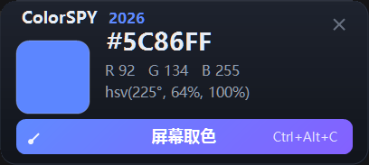
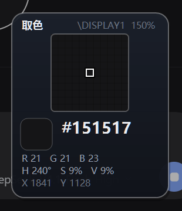

# ColorSPY 2026

[English](README.en.md) | 简体中文

右下角托盘取色小工具：平时只占一个小条；点“屏幕取色”或按 `Ctrl+Alt+C` 才进入全屏拾取模式，鼠标变十字、带放大镜，点击只取色，不会触发下面任何程序。

Windows 10 / 11 · .NET Framework 4.8 · 单文件 · 无 Flash · 不联网





## 功能

- 启动后吸附在桌面右下角（任务栏上方），显示上一次取到的颜色：HEX / RGB / HSV。
- 常驻托盘图标：双击开始取色，右键可开始取色 / 显示面板 / 退出。
- 取色模式：鼠标变十字，光标旁 11×11 像素放大镜，中心格高亮。
- 单击取色并自动复制 HEX；右键 / `Esc` 取消；滚轮缩放；方向键 1px 微调（`Shift` 10px）。
- 取色时有一层覆盖整个虚拟桌面的全屏层，按下和抬起都被它接收，所以点击不会落到浏览器、编辑器或游戏里。
- 单击色块复制 HEX；拖动小条移动位置并记住；右键菜单可置顶、复制、隐藏到托盘。
- 多显示器、负坐标、混合 DPI、显示器热插拔。

## 使用

1. 运行 `ColorSPY2026.exe`（首次运行请先看下面的 SmartScreen 说明）。
2. 小条出现在右下角；点“屏幕取色”或按 `Ctrl+Alt+C`。
3. 移动鼠标，用放大镜对准像素，单击取色；颜色会自动复制到剪贴板。
4. `Esc` 隐藏小条到托盘；右上角 × 退出。

## 多显示器

- 拾取层按每块显示器分别截图再拼接，副屏在左侧（负坐标）也正确。
- 放大镜按光标所在显示器的 DPI 缩放；小条在 100% / 150% 屏幕间移动时自动重排。
- 换分辨率、拔插显示器后，小条会自动回到可见区域。

## 构建

需要 Windows 自带的 .NET Framework 4.x 编译器（无需安装 SDK、无需联网）：

```bat
build.cmd
```

输出 `ColorSPY2026.exe`。`build.cmd` 会先用 `tools\IconMaker.cs` 生成多尺寸图标，再编译 `src` 下的源码。

GitHub Actions 会在 push 时构建并上传 `ColorSPY2026` artifact；推送 `v*` 标签时会自动创建 Release 并附上 exe。

## SmartScreen

exe 没有数字签名，资源管理器直接双击时，Windows SmartScreen 可能弹出“Windows 已保护你的电脑”。

- 推荐运行 `launch.cmd`：它由 cmd 启动 exe，不经过资源管理器的 SmartScreen 检查。
- 或在提示里点“更多信息 → 仍要运行”。
- 彻底消除提示需要给 exe 做代码签名（受信任的证书；EV 证书可立即建立信誉）。自签名证书不能消除 SmartScreen。

## 目录

- `src\Program.cs`：入口、单实例、DPI 感知、崩溃日志
- `src\SpyForm.cs`：右下角托盘小条、托盘图标、菜单、热键、取色流程
- `src\PickOverlay.cs`：全屏拾取层（十字光标、放大镜、点击拦截）
- `src\ColorMath.cs`：HEX / RGB / HSV 转换
- `src\Theme.cs`：配色与绘制辅助
- `src\State.cs`：位置、置顶、上次颜色持久化
- `src\app.manifest`：PerMonitorV2 声明
- `tools\IconMaker.cs`：生成多尺寸 .ico
- `launch.cmd`：不经过 SmartScreen 的启动器

## 许可

MIT，见 [LICENSE](LICENSE)。

## 声明

本项目是独立重制，灵感来自 2000 年代的 Windows 取色工具；与原版 `ColorSPY`、`Quester's ColorKey` 的作者和发行方无关。仓库不包含任何原版二进制文件。
